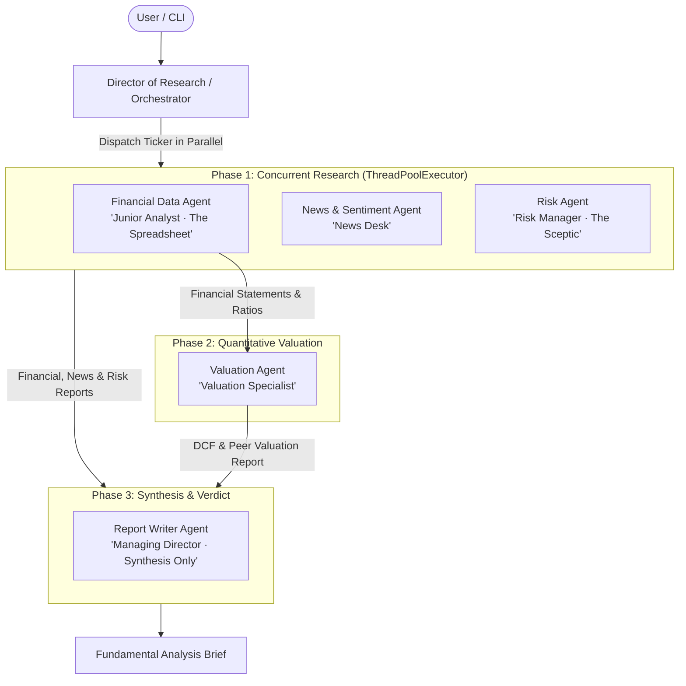

# FinAdvisor AI (v0)

A multi-agent autonomous financial advisory and equity research system powered by **Strands Agents** and **Amazon Bedrock**. FinAdvisor AI coordinates a team of specialized AI analysts across a 3-phase research workflow to generate institutional-grade **Fundamental Analysis Briefs** for any publicly traded stock.

---

## 🌟 Key Highlights

- **3-Phase Deterministic Multi-Agent Architecture**: Concurrently collects fundamentals, news, and risk metrics, runs quantitative valuation, and synthesizes institutional investment briefs.
- **Powered by Strands Agents & AWS Bedrock**: Leverages advanced LLMs (e.g., Anthropic Claude 3.5 Sonnet) with tool-calling capabilities.
- **Real-Time Market & Financial Data**: Live financial statements (Income Statement, Balance Sheet, Cash Flow), ratios, and market headlines via `yfinance`.
- **Quantitative DCF & Peer Multiples Modeling**: Calculates intrinsic value, discount rates (WACC), terminal values, and peer group valuation benchmarks.
- **Deterministic Rating Table**: Maps valuation and downside risk matrix directly to actionable ratings (`STRONG BUY`, `BUY`, `HOLD`, `SELL`, `STRONG SELL`).

---

## 🏗️ Architecture & Workflow

FinAdvisor AI executes an orchestrated 3-phase research workflow designed to prevent hallucination, minimize latency via parallel execution, and preserve specialized agent roles:



### 3-Phase Execution Plan

1. **Phase 1: Parallel Data Retrieval (`ThreadPoolExecutor`)**
   - **Financial Data Agent** retrieves annual/quarterly Income Statements, Balance Sheets, and Cash Flows, computing revenue trajectory, Gross Margin, Net Margin, and ROE.
   - **News & Sentiment Agent** fetches recent news, earnings releases, and catalysts, evaluating market sentiment (`BULLISH`, `NEUTRAL`, `BEARISH`).
   - **Risk Agent** audits balance sheet leverage, liquidity vulnerabilities, debt serviceability, and downside headlines (`LOW`, `MODERATE`, `ELEVATED`, `HIGH RISK`).

2. **Phase 2: Quantitative Valuation**
   - **Valuation Agent** receives financial context from Phase 1 and runs:
     - Discounted Cash Flow (DCF) model using free cash flow, projected growth, WACC discount rate, and terminal value.
     - Peer multiples comparison (P/E, EV/EBITDA, P/S).
     - Calculates intrinsic price, margin of safety, and upside/downside percentage.

3. **Phase 3: Synthesis & Investment Brief**
   - **Report Writer Agent** receives all 4 specialist reports, applies the institutional **Rating Table Matrix**, and formats the final executive **Fundamental Analysis Brief**.

---

## 🎯 Rating Table Matrix

The final rating is determined by cross-referencing Valuation and Downside Risk:

| Valuation Verdict | Risk Verdict | Investment Rating |
| :--- | :--- | :--- |
| **Significantly Undervalued** | Low Risk | `STRONG BUY` |
| **Undervalued** | Low / Moderate Risk | `BUY` |
| **Fairly Valued** (or Mixed Signals) | Any | `HOLD` |
| **Overvalued** | Moderate / Elevated Risk | `SELL` |
| **Significantly Overvalued** | Elevated / High Risk | `STRONG SELL` |

---

## 📂 Project Structure

```text
finadvisor-ai-v0/
├── agents/                      # Specialized Strands Agent definitions
│   ├── __init__.py              # Exports all agents and orchestrators
│   ├── financial_data_agent.py  # Financial statement parsing & ratio analysis
│   ├── news_sentiment_agent.py  # Market news search & sentiment classification
│   ├── risk_agent.py            # Balance sheet & operational risk auditing
│   ├── valuation_agent.py       # DCF & peer multiples valuation modeling
│   ├── report_writer_agent.py   # Final synthesis & report formatting
│   └── orchestrator.py          # 3-phase execution engine & director agent
├── lib/
│   ├── __init__.py
│   └── model.py                 # Amazon Bedrock model configuration
├── tools/                       # Tool functions with caching (@tool)
│   ├── __init__.py
│   ├── financial_tools.py       # yfinance financial statement retrievers
│   ├── news_tools.py            # News search & sentiment scoring
│   └── valuation_tools.py       # DCF runner & peer multiples fetcher
├── utils/
│   ├── __init__.py
│   └── valuation_utils.py       # Pure DCF, WACC, & cash-flow mathematics
├── .env.example                 # Environment configuration template
├── main.py                      # CLI entry point
├── requirements.txt             # Project dependencies
└── README.md                    # Project documentation
```

---

## 🚀 Getting Started

### 1. Prerequisites

- **Python 3.10+**
- **AWS Account** with Amazon Bedrock model access enabled (e.g., Anthropic Claude 3.5 Sonnet, Claude Haiku, or Amazon Nova).

### 2. Installation

Clone the repository and set up a Python virtual environment:

```bash
# Clone repository
git clone https://github.com/rohit-kaurav/finadvisor-ai-v0.git
cd finadvisor-ai-v0

# Create virtual environment
python3 -m venv .venv
source .venv/bin/activate    # On Windows: .venv\Scripts\activate

# Install dependencies
pip install -r requirements.txt
```

### 3. Environment Configuration

Copy `.env.example` to `.env` and provide your AWS credentials and preferred Bedrock model:

```bash
cp .env.example .env
```

Configure your `.env`:

```ini
# AWS Bedrock Configuration
AWS_ACCESS_KEY_ID=your_aws_access_key
AWS_SECRET_ACCESS_KEY=your_aws_secret_key
AWS_DEFAULT_REGION=us-east-1
BEDROCK_MODEL_ID=anthropic.claude-3-5-sonnet-20241022-v2:0
```

---

## 💻 Usage

Run the analysis CLI for any US stock ticker (default is `AAPL`):

```bash
# Analyze Apple Inc.
python main.py AAPL

# Analyze Tesla Inc.
python main.py TSLA

# Analyze Microsoft Corporation
python main.py MSFT
```

Or invoke the orchestrator directly as a module:

```bash
python -m agents.orchestrator NVDA
```

---

## 📊 Sample Output

```text
=============================================================
FUNDAMENTAL ANALYSIS BRIEF
Apple Inc. (AAPL) | Technology / Consumer Electronics
=============================================================

INVESTMENT VERDICT
  Valuation verdict (from ValuationAgent): MODERATELY OVERVALUED
  Risk verdict (from RiskAgent):           LOW RISK
  Applying rating table =>                 HOLD

  Sentiment:       BULLISH
  Intrinsic Value: $192.40 per share (DCF)
  Current Price:   $231.50
  Upside/Downside: -16.89%

FINANCIAL HEALTH
  - Revenue rose from $383,285M (2023) to $391,035M (2024)
  - Gross margin ~46.2%, net margin ~24.0%, ROE ~158%

VALUATION ANALYSIS
  - DCF: $192.40 per share, 16.89% below the market price
  - Peers: trades at a 14.5% premium to consumer tech peer median

MARKET SENTIMENT
  - Bullish momentum driven by Apple Intelligence feature rollouts and strong iPhone 16 upgrade cycle demand.

RISK FACTORS
  - Greater China hardware sales sensitivity and elevated antitrust scrutiny in the US & EU app ecosystem.

BULL / BASE / BEAR CASE
  - Bull: Faster-than-anticipated AI services monetization and expanding services multiples.
  - Base: Steady single-digit iPhone replacement cycle and stable 70%+ services gross margins.
  - Bear: Softening consumer discretionary hardware spend and regulatory fee compression.

CONCLUSION
  - While Apple exhibits exemplary cash flow generation and pristine balance sheet health, current trading multiples leave limited margin of safety. A HOLD rating is recommended at prevailing prices.

This report is for educational purposes only. Not financial advice.
```

---

## 🛡️ Disclaimer

This software is developed strictly for **educational and research purposes**. None of the outputs, ratings, intrinsic valuations, or commentary generated by this application constitute financial, legal, or investment advice. Always perform your own independent due diligence or consult a licensed financial advisor.
